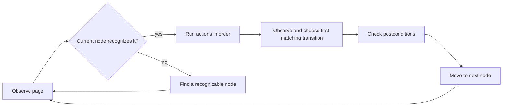

# Workflow YAML language guide

This is the authoring manual for the engine's declarative workflow language. A graph
describes recognizable page states, actions, and the conditions that choose the next
state. YAML supplies the syntax; the engine supplies the meaning. Knowing YAML alone is
not enough to predict execution, so this guide explains both.

This documentation was checked against the implementation on **2026-10-25**. The graph's
`version` is an author-managed revision, not a language-version selector. Use the
repository's installed engine and builder schema when checking compatibility.

## Reading paths

| Your goal | Read |
|---|---|
| Build your first workflow | [Tutorial](tutorial.md) |
| Look up a field, action, condition, or default | [Language reference](reference.md) |
| Call an API, retrieve a 2FA code, poll email, or use several authenticators | [Requests and 2FA](requests-and-2fa.md) |
| Extract data, transform values, or run JavaScript | [Code and extraction](code-and-extraction.md) |
| Understand execution order, retries, resynchronization, or failures | [Runtime and debugging](runtime-and-debugging.md) |
| Run commands or connect credentials in this repository | [Repository integration](integration.md) |
| Start from a complete graph | [Example catalog](examples/README.md) |

Read the tutorial, then the runtime chapter before deploying a real workflow. Keep the
reference open while editing. The request chapter addresses the common requirement
"obtain a current code from my platform without knowing the authenticator seed."

## The building blocks

| Construct | Question it answers |
|---|---|
| `inputs` | What information does this run receive? |
| `targets` | How can the observer identify the controls the workflow uses? |
| `requests` | Where do values fetched during execution come from? |
| `nodes` | What recognizable states and terminal results exist? |
| `recognize` | Is the current observation appropriate for this node? |
| `actions` | What should happen, sequentially, after recognition? |
| `transitions` | Which next node should be selected from the resulting observation? |
| `postconditions` | What else must be true before accepting that transition? |
| `outputs` | Which top-level runtime variables should be returned at a terminal? |

A node is not automatically a URL, a screenshot, or one click. It is an authored unit of
recognition and work. Several nodes may operate on the same page. A terminal is a result,
not another page to recognize.

## What is implemented

Implemented: page predicates, ordered targets, browser actions, bounded loops, failure
routing, HTTP/TOTP/IMAP requests, field/table extraction, sandboxed JavaScript, and
JavaScript evaluated in the browser.

Parsed but **not executable**: `call` nodes and `call` actions. `imports` does not load
subgraphs. Output labels and extraction `schema` labels do not validate a JSON schema.
`on_fail: repair` stops for diagnosis; it does not invoke an automated repair model.
There is no YAML human-approval or "wait for a person to enter an OTP" action.

## How to use the examples

Files in [examples/](examples/README.md) are complete graphs checked by the compiler.
Code blocks elsewhere are **fragments** unless explicitly described as complete. Merge
fragments into the existing `inputs`, `requests`, `nodes`, or `targets` mapping; do not
paste a second mapping with the same top-level key. YAML loaders can silently replace
the first value when a key is duplicated.

The examples use fictional Acme Records pages or configurable endpoints. Compiler
validation checks their structure, references, and JavaScript syntax; it does not prove
that a live page or an external service has the expected controls or response contract.

See [integration](integration.md) for the example validation command, the source files
behind this manual, and the features specific to this repository.

See [rendered images](images.md) for capture and model requests, and
[engine embedding](integration.md#engine-and-host-boundary) for the caller boundary.
